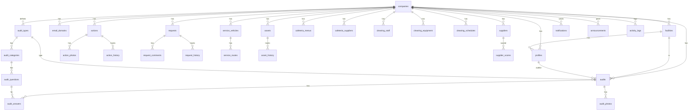

# 🗄️ İdari360 — Veritabanı Dokümantasyonu

## 📐 Mimari Genel Bakış

İdari360, **çok kiracılı (multi-tenant)** bir SaaS platformudur. Her şirket kendi verisini yalnızca kendi kapsamında görebilir. Veri izolasyonu PostgreSQL'in **Row Level Security (RLS)** mekanizması ile veritabanı seviyesinde sağlanır.

### Tenant Hiyerarşisi

```
Sistem
└── Şirket (Company)
    └── Tesis (Facility)
        └── Kullanıcı (Profile)
```

---

## 🔑 Rol Sistemi

Roller, `app_role` enum tipi ile tanımlanır ve sayısal seviye ile karşılaştırılır:

| Rol | Seviye | Açıklama |
|-----|--------|----------|
| `super_admin` | 100 | Tüm sisteme tam erişim. Şirket oluşturma, admin atama |
| `company_admin` | 80 | Kendi şirketinde tam erişim. Tesis ve kullanıcı yönetimi |
| `facility_manager` | 60 | Kendi şirketi + kendi tesisinde tam erişim |
| `facility_officer` | 40 | Kendi şirketi + kendi tesisinde tam erişim |
| `employee` | 20 | Kendi şirketi + kendi tesisi + sadece kendi verileri |

### Güvenlik Kuralları

1. **Rol Yükseltme Yasağı** — Hiçbir kullanıcı kendi rolünü yükseltemez
2. **Eşit/Üst Rol Yönetim Yasağı** — Kullanıcı, kendi seviyesindeki veya üstündeki rolleri atayamaz/kaldıramaz
3. **Şirket İzolasyonu** — Şirketler arası veri erişimi kesinlikle engellenir
4. **Süper Admin Tekel** — Şirket oluşturma ve `company_admin` atama yalnızca `super_admin` yapabilir

---

## 📊 Veritabanı Diyagramı (ER)



---

## 📋 Tablo Açıklamaları

### Çekirdek Tablolar

| Tablo | Açıklama |
|-------|----------|
| `companies` | Şirket bilgileri, abonelik planı, ayarlar |
| `facilities` | Şirkete bağlı tesisler (şubeler) |
| `profiles` | Kullanıcı profilleri (`auth.users` ile 1:1 ilişki) |
| `email_domains` | Şirket-email domain eşleştirmesi |

### Denetim Modülü

| Tablo | Açıklama |
|-------|----------|
| `audit_types` | Denetim türleri (yemekhane, servis, temizlik vb.) |
| `audit_categories` | Denetim kategorileri (Hazırlık, Sanitasyon vb.) |
| `audit_questions` | Denetim soruları ve puanları |
| `audits` | Gerçekleştirilen denetimler |
| `audit_answers` | Denetim cevapları (evet/hayır/na) |
| `audit_photos` | Denetim fotoğrafları |

### Aksiyon Takibi

| Tablo | Açıklama |
|-------|----------|
| `actions` | Uygunsuzluk aksiyonları |
| `action_photos` | Aksiyon kanıt fotoğrafları |
| `action_history` | Aksiyon durum değişiklik geçmişi |

### Talep & Onay

| Tablo | Açıklama |
|-------|----------|
| `requests` | Talep kayıtları (yemekhane, servis, temizlik vb.) |
| `request_comments` | Talep yorumları |
| `request_history` | Talep durum değişiklik geçmişi |

### Servis Yönetimi

| Tablo | Açıklama |
|-------|----------|
| `service_vehicles` | Servis araçları (plaka, marka, model, sürücü) |
| `service_routes` | Servis güzergahları |

### Yemekhane Yönetimi

| Tablo | Açıklama |
|-------|----------|
| `cafeteria_menus` | Günlük menüler |
| `cafeteria_suppliers` | Yemekhane tedarikçileri |

### Temizlik Yönetimi

| Tablo | Açıklama |
|-------|----------|
| `cleaning_staff` | Temizlik personeli |
| `cleaning_equipment` | Temizlik ekipmanları |
| `cleaning_schedules` | Temizlik planları |

### Varlık Yönetimi

| Tablo | Açıklama |
|-------|----------|
| `assets` | Demirbaş/varlık kayıtları |
| `asset_history` | Varlık hareket geçmişi (zimmet, devir, iade vb.) |

### Tedarikçi Performansı

| Tablo | Açıklama |
|-------|----------|
| `suppliers` | Tedarikçi bilgileri |
| `supplier_scores` | Dönemsel performans puanları |

### Sistem Tabloları

| Tablo | Açıklama |
|-------|----------|
| `notifications` | Kullanıcı bildirimleri |
| `scheduled_reminders` | Planlı hatırlatmalar |
| `announcements` | Duyurular |
| `activity_logs` | Sistem aktivite kayıtları |
| `otp_codes` | E-posta doğrulama kodları |

---

## 🔒 RLS Politikaları

### Genel Prensipler

1. **Tüm tablolarda RLS aktif** — İstisnasız her tablo korunur
2. **company_id filtresi** — Her sorgu, kullanıcının şirketine göre filtrelenir
3. **facility_id filtresi** — Tesis bazlı roller için ek filtreleme
4. **super_admin bypass** — Süper admin tüm verilere erişir

### Yardımcı Fonksiyonlar

| Fonksiyon | Dönüş | Açıklama |
|-----------|-------|----------|
| `get_user_role()` | `app_role` | Mevcut kullanıcının rolü |
| `get_user_company_id()` | `uuid` | Mevcut kullanıcının şirket ID'si |
| `get_user_facility_id()` | `uuid` | Mevcut kullanıcının tesis ID'si |
| `is_super_admin()` | `boolean` | Süper admin kontrolü |
| `has_role_or_higher(role)` | `boolean` | Rol seviye karşılaştırması |
| `role_level(role)` | `integer` | Rolün sayısal seviyesi |
| `can_manage_user(uid)` | `boolean` | Hedef kullanıcıyı yönetebilir mi |

### Güvenlik Trigger'ları

| Trigger | Tablo | Açıklama |
|---------|-------|----------|
| `validate_role_change` | `profiles` | Rol değişikliğini doğrular, kendi rolünü yükseltmeyi engeller |
| `enforce_company_isolation` | `*` | Şirketler arası veri sızıntısını engeller |

---

## 📐 Migration Dosyaları

| Sıra | Dosya | İçerik |
|------|-------|--------|
| 1 | `001_core_schema.sql` | Enum'lar, tablolar, indexler, trigger'lar |
| 2 | `002_rls_policies.sql` | RLS politikaları, güvenlik fonksiyonları |
| 3 | `003_seed_data.sql` | Başlangıç verileri (denetim soruları) |

> ⚠️ Migration dosyaları **sırasıyla** çalıştırılmalıdır.
